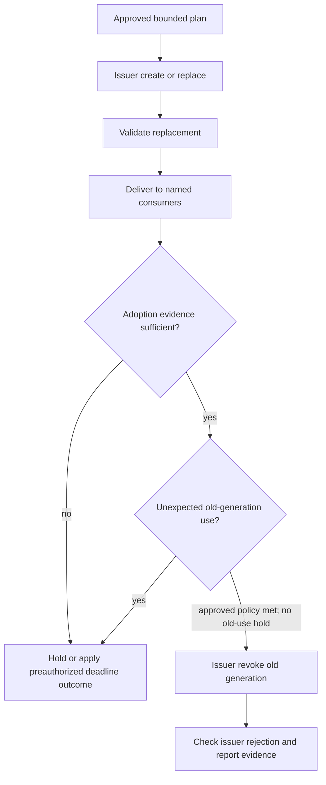
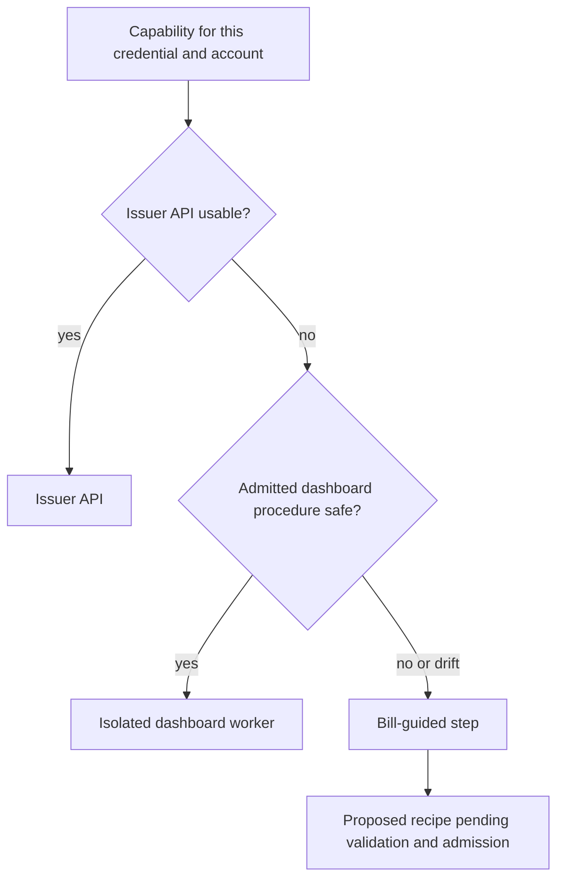
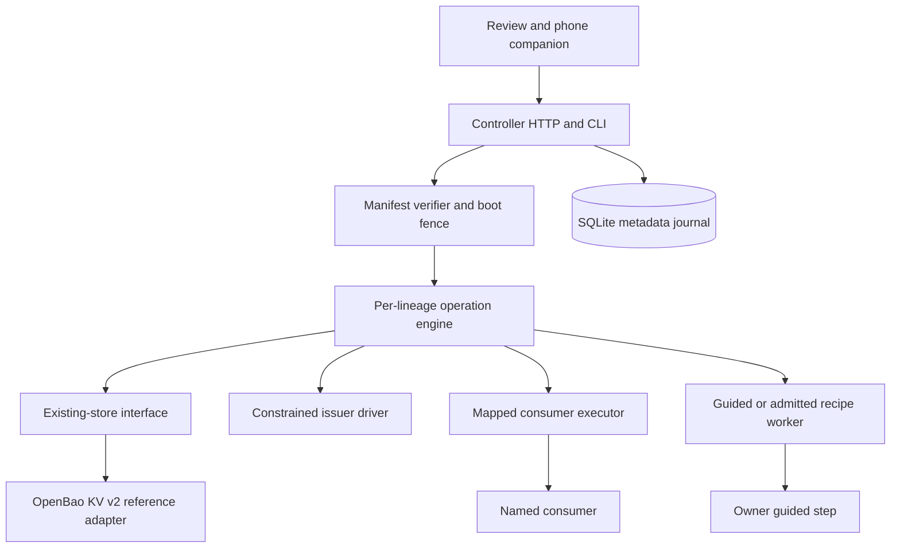

# Keyroot Credential Lifecycle - Plan

## Goal Capsule

- **Objective:** Bill can replace or eliminate an affected credential across his declared consumers with less active work, while seeing which consumers and issuer outcomes remain unverified.
- **Means:** A small lifecycle coordinator uses an existing self-hosted secrets store, issuer-supported actions, admitted dashboard workflows, and guided steps.
- **Product authority:** Bill approved this scope for his personal four-machine setup and connected platforms; this document records product behavior, not permission for live credential operations.
- **Open blockers:** None before implementation planning; account capabilities, enforcement, recovery, and operating cost require evidence during planning and validation.
- **Execution profile:** Build and review the local coordinator, adapters, companion approval flow, and selected review UI; keep real credential mutation disabled until its account, store, signer, authority, and recovery gates pass.
- **Product Contract preservation:** R1–R80, F1–F8, and AE1–AE27 remain unchanged; R81 and AE28 record Bill's selected light/dark experience, while R82–R83 add inferred theme-continuity behavior for review. The Problem Frame and source-provenance wording remove private history and local input links without changing product behavior.

---

## Product Contract

### Summary

Keyroot maps credential lineages to the places that use them, plans changes, obtains bounded approval, coordinates replacement, and reports adoption and revocation evidence. It first recommends eliminating eligible static credentials through an existing issuer-supported workload identity; remaining credentials use issuer APIs, admitted dashboard procedures, or guided updates. It preserves native subscription logins and uses an existing store rather than becoming another vault.

### Problem Frame

Credential sprawl across machines, hosting, CI, AI tools, and connected platforms makes it difficult to find every consumer and coordinate a safe replacement. The source plan's inventory counts and vendor percentages are owner-reported context, not independently audited coverage. Issuers differ in key creation, overlap, revocation, OAuth, dashboard, and account entitlement, while a pushed replacement may not be in use. A single green status can hide an offline consumer, a still-active old key, or a copied value outside Keyroot's control.

### Key Decisions

- **Personal lifecycle coordinator.** (session-settled: user-approved — chosen over a store plus guided checklist alone: the proposed coordinator addresses cross-consumer evidence and incident scope, subject to the owner-time comparison in R79.) Governs R1, R2, R79.
- **Use existing identity only where eligible.** (session-settled: user-approved — chosen over a new identity provider: issuer, account, and consumer eligibility can be checked without new identity infrastructure.) Governs R8, R9.
- **Keep production independent of the box.** (session-settled: user-approved — chosen over routing production requests or refresh through Keyroot: an always-on personal box must not become a production dependency.) Governs R10, R49, R50.
- **API, admitted dashboard, then guided fallback.** (session-settled: user-approved — chosen over unattended browser learning by default: dashboard authority and secret-safe observations require proof per procedure.) Governs R12, R57–R66.
- **Bound weekly approval.** (session-settled: user-approved — chosen over an open-ended standing window: repeated rotations and changed scope need finite authority.) Governs R22–R29.
- **Truthful partial outcomes.** (session-settled: user-approved — chosen over treating a push or attempted revoke as completion: consumer use and issuer rejection need separate evidence.) Governs R32–R47.
- **Independent recovery.** (session-settled: user-approved — chosen over relying on the emergency YubiKey alone: an approver cannot restore a lost vault or compromised issuer access.) Governs R73–R76.
- **Selected review experience.** (session-settled: user-approved — use the selected warm editorial layout in light and dark appearances.) Governs R81.
- **Theme continuity.** (design inference — follow system appearance initially, persist an explicit choice, and preserve work in progress when appearance changes.) Governs R82–R83.

### Actors

- A1. Bill owns scope, approval, risk overrides, MFA, guided actions, and recovery decisions.
- A2. Keyroot controller coordinates plans, approvals, inventory, operations, and evidence on Bill's tailnet box.
- A3. Existing secrets store holds intended secret versions and supplies authorized delivery integrations.
- A4. Consumer delivery identities obtain only mapped material and have no owner administration authority.
- A5. Connector executors act at issuer or consumer interfaces within their actual enforced authority.
- A6. Issuers and platforms determine credential validity, account entitlements, session behavior, and supported actions.
- A7. Consumers are named tools, processes, deployments, CI jobs, platforms, and the four machines that use a credential.

### Requirements

**Inventory and coverage**

- R1. Keyroot serves Bill's four machines and connected platforms from a dedicated tailnet box that does not host arbitrary third-party development agents or MCP servers.
- R2. The controller reuses an existing self-hosted secrets store for intended secret versions and supported sync.
- R3. Discovery inspects authorized machine and platform sources read-only and lists unplaced, inaccessible, and unscanned sources.
- R4. The inventory distinguishes issuer, account, credential type, lineage, generation, grant identity, and each named consumer binding.
- R5. Each association records its source, last observation, and whether it was declared, observed, or inferred.
- R6. Discovery never revokes or replaces an existing value until Bill separately approves a migration plan.
- R7. Keyroot shows coverage per credential, account, and consumer without implying unknown or dormant copies are absent.
- R8. Keyroot recommends removing a stored static credential only when an existing issuer, Bill's account entitlement, and that consumer support native workload federation.
- R9. A federation migration verifies that the consumer uses the new identity and no static-key fallback takes precedence before retiring the key.
- R10. Production applications and CI have no Keyroot request-time or refresh-time dependency.
- R11. Credentials that cannot be rotated safely remain inventoried with their manual or unknown coverage visible.

**Capability, delivery, and authority**

- R12. Each credential/account/consumer capability record distinguishes documented, account-tested, and unavailable create, validate, deliver, observe, and revoke actions.
- R13. A consumer uses a supported native integration, managed delivery, assisted update, or inventory-only path according to its verified capabilities.
- R14. Each external consumer gets its own credential by default where the issuer permits, with one slot reserved for replacement overlap.
- R15. Dev-machine consumers share one box-delivered credential by default, while Bill may choose another allocation including per-device keys where capacity and maintenance permit.
- R16. When slots prevent that allocation, Keyroot first evaluates sharing or consolidation to restore overlap and labels any remaining non-overlap replacement for R43's outage route.
- R17. Dev-machine tools other than native subscription clients may use mapped local helpers or launch wrappers for credential delivery.
- R18. Consumer delivery authority permits only mapped material and cannot administer or enumerate the store.
- R19. Owner administration, consumer delivery, and connector execution use separate authorities.
- R20. A claimed connector action limit requires a trusted executor that mediates every privileged action and a runtime that cannot bypass it.
- R21. Owner administration of the box or store requires Bill's phone-signed approval rather than tailnet identity, with the enrolled YubiKey limited to its emergency role under R74.

**Schedules and approval**

- R22. Bill sets a credential interval from 1 to 90 days, with longer custom intervals allowed only with a warning.
- R23. The schedule forecasts owner prompts and respects earlier issuer expiry or required reauthorization.
- R24. A weekly phone review presents a finite batch or bounded schedule of credential lineages, accounts, consumer-map revision, admitted recipe versions, execution and new-credential counts, restart budget, time range, adoption-evidence threshold, overlap policy, outage permission, and expiry.
- R25. Bill's phone-held key or emergency-only YubiKey signs each approval bound to its listed operation instances and expected generation succession, while changed consumers, privileges, recipes, or outage behavior require new approval.
- R26. Each authorized instance is consumed once, and restore invalidates outstanding approvals pending issuer-state reconciliation.
- R27. Expired approval permits observation and reconciliation but no new mutation without fresh authority.
- R28. Valid bounded preapproval does not require another Keyroot phone tap for each run, while missing approval, changed scope, issuer MFA, and fresh consent wait for Bill.
- R29. Bill can cancel optional future mutations in a standing approval without undoing completed revocation or separately authorized containment.

**Replacement and evidence**

- R30. Keyroot serializes changes to one credential lineage and reconciles an interrupted or ambiguous issuer action before retrying it.
- R31. Each change exposes a stable operation reference and resumable progress with separate outcomes for creation, delivery, adoption, issuer revocation, and observed issuer rejection.
- R32. An overlap-capable routine change creates and validates the replacement before publishing it to mapped consumers.
- R33. Delivery accepted, direct use by a named deployment/process/job, and inferred or unknown adoption are distinct receipt classes.
- R34. A consumer receipt identifies the generation, consumer revision or run, observation time, proof method, and limitations.
- R35. A generic health check, cached connection, queued job, quiet old key, or possible fallback never alone proves the named consumer adopted the new generation.
- R36. Ordinary revocation requires the declared adoption-evidence threshold for each mapped consumer or Bill's informed override.
- R37. A consumer without direct adoption proof uses an agreed maintenance or test window and remains labeled uncertain.
- R38. If a consumer is offline or fails, Keyroot holds ordinary revocation where overlap permits and reports the affected consumer.
- R39. Keyroot holds ordinary revocation and flags unresolved use when issuer telemetry shows old-generation activity after mapped cutover, without treating absent telemetry as clearance or overriding separately authorized hard deadlines or incident containment.
- R40. Every operation declares its deadline outcome before execution.
- R41. A routine review deadline stops further optional change, retains a still-valid old value if needed, and reports partial or overdue exposure for Bill's decision.
- R42. A hard revoke or expiry deadline is allowed only for a concrete issuer-supported action and separately preauthorized outage consequence.
- R43. A single-key issuer requires an explicitly acknowledged outage and recovery path before replacement.
- R44. Keyroot regularly checks current credential validity with issuer-safe methods and alerts Bill with an emergency replacement option on verified unexpected revocation.
- R45. Keyroot reports issuer control-plane revocation separately from data-plane rejection, including any documented propagation limit.
- R46. Old-generation outcome is confirmed revoked on issuer-safe revocation or authentication-rejection evidence, confirmed active on an accepted old-key probe, and unverified on timeout, rate limit, scope error, or unsupported check.
- R47. Raw values leave the store only for issuer action or authorized mapped delivery, never for owner-operation responses, model context, logs, recordings, records, or reports.

Routine overlap path (R32–R43); R39 is the old-use hold, while R42 and R70 govern separately authorized exceptions.



**OAuth and native sessions**

- R48. The inventory distinguishes OAuth app secrets, access tokens, refresh-token families, and user grants without treating them as interchangeable keys.
- R49. Issuer or native client behavior owns routine refresh for production and third-party clients while Keyroot tracks expiry and coordinates required reauthorization.
- R50. Only a specifically Keyroot-owned local grant may use one fenced refresh owner, with stale restored families reconciled or reconsented before use.
- R51. Emergency OAuth grant containment revokes the grant before reconsent and records issuer support and residual access-token lifetime before declaring containment.
- R52. Claude Code and Codex retain native subscription sign-in without Keyroot key-helper or provider-login substitution.
- R53. Keyroot uses each native client's supported OS credential-store path for subscription material where available.
- R54. Keyroot flags subscription material it detects in plaintext files and labels unsupported secure-storage coverage.
- R55. Keyroot offers subscription sign-out only through supported provider or client capabilities and reports unsupported remote sign-out.
- R56. Keyroot alerts Bill to new-place subscription use only where session telemetry exists, with unavailable telemetry labeled unknown.

**Dashboard and guided work**

- R57. Credential creation and consumer updates use an issuer API first, an admitted dashboard procedure next, and guided execution when neither is safe or available.
- R58. A dashboard worker is isolated from store administration, host files, and other issuer sessions during use, with its profile sealed between runs.
- R59. Dashboard session or broad admin-token authority is reported as account-level blast radius unless issuer scope and enforceable mediation narrow it.
- R60. Browser learning produces a proposed versioned recipe rather than executable authority.
- R61. Unattended reuse requires a validated procedure, one-time owner admission, pinned version, and drift check.
- R62. A model sees only a proven sanitized, bounded observation channel; code handles secret capture and allowed actions without exposing values to the model.
- R63. Vendor pages, support content, and stored prompts are untrusted inputs and cannot change the admitted action scope.
- R64. Unexpected layout, account, privilege, destination, secret-bearing observation, or MFA requirement pauses unattended action for guided handling.
- R65. A failed or changed recipe stays guided until re-admitted, and Bill may set any vendor to guided-only.
- R66. Hosted-model disclosure for a dashboard procedure requires evaluation before that procedure is enabled.



**Incident, continuity, and recovery**

- R67. Bill may select individual credentials or a vendor/platform scope for emergency action and approve the resulting finite set.
- R68. Emergency policy distinguishes continuity-first replacement from revoke-first outage and never replays a known leaked generation for continuity.
- R69. A compromised consumer destination is quarantined from replacement delivery until its trust is restored or Bill explicitly accepts the residual risk.
- R70. If a routine operation becomes an incident, only separately authorized containment runs while unapproved risk changes wait for Bill.
- R71. Incident reporting separates containment confirmed or unconfirmed, restored or affected service, and action required, with detailed receipts available.
- R72. On box outage, local delivery controls stop managed processes still holding fetched material after Bill's 15–30 minute grace or earlier issuer expiry; unmanaged copies and platform consumers follow their own validity.
- R73. Recovery from permanent box loss requires a tested encrypted backup, independent decryption material, independent inventory, and clean-device issuer-native access even when the normal phone is unavailable.
- R74. The enrolled YubiKey may approve emergencies when the phone is unavailable but is not itself vault or issuer-account recovery.
- R75. Suspected root compromise requires clean issuer-admin recovery, replacement of compromised management authority, supported session invalidation, and a rebuilt trusted controller before receiving new secrets.
- R76. Recovery does not reactivate stale approvals, privileged sessions, or OAuth refresh families and reports authority that cannot be invalidated.

**Owner effort and value**

- R77. The five-credential emergency ambition is under five minutes of all Bill's active time from selection through final report, including approvals, MFA, guided steps, troubleshooting, and review.
- R78. Keyroot reports unsupported inventory coverage and measures unattended wait, containment elapsed time, and restoration elapsed time separately from owner time.
- R79. Added coordination must reduce total owner handling and repair time against an existing-store-plus-guided-checklist baseline on the same credential set, with license and maintenance costs visible.

**Privileged control dependencies**

- R80. The inventory names Keyroot's store root and recovery material, issuer-admin credentials, platform push tokens, approval identities, and dashboard sessions with each authority's owner and recovery dependency.

**Review appearance**

- R81. The review interface follows Bill's selected warm editorial layout and offers both light and dark appearances with equivalent information and actions.
- R82. On first visit the interface follows the system appearance and persists a later explicit theme choice across visits.
- R83. Changing appearance preserves the current batch, approval draft, selected credential, and operation progress without resetting the workflow.

### Key Flows

- F1. **Discover and admit a credential.** A1 authorizes read-only discovery; A2 records typed identities, named consumers, privileged dependencies, evidence, and gaps; A1 selects allocation and separately approves any migration. Covers R3–R9, R11–R16, R80.
- F2. **Approve a routine window.** A2 forecasts due operations; A1 reviews and authorizes bounded instances; A2 consumes each once and requests renewed authority for drift or expiry. Covers R22–R29.
- F3. **Replace a credential.** A5 creates or guides a replacement; A3 delivers to A7; A2 checks adoption and unexpected old-generation use, applies the deadline policy, checks issuer revocation, and reports uncertainty. Covers R30–R47, R57.
- F4. **Run or learn a dashboard procedure.** A5 uses an admitted isolated worker or A1 guides; a guided trace becomes a proposal, and only validated owner admission permits later unattended reuse. Covers R58–R66.
- F5. **Contain a reported leak.** A1 selects scope and continuity policy; A2 quarantines unsafe destinations, coordinates issuer actions, and reports containment and service independently. Covers R67–R71.
- F6. **Renew or revoke an OAuth grant.** The native owner refreshes routine grants; A2 coordinates consent or emergency issuer revocation and reports residual token validity. Covers R48–R51.
- F7. **Recover the control plane.** A1 uses independent recovery material for box loss or a clean issuer-admin route after compromise; A2 reconciles state before accepting new authority. Covers R26, R73–R76.
- F8. **Preserve native subscriptions.** A2 checks each supported client storage path and available provider session capability while A1 retains native login and handles any supported sign-out. Covers R52–R56.

### Acceptance Examples

- AE1. **Covers R1–R7.** Given the dedicated box and reused store, when a read-only scan finds a named key, an unreadable CI secret, and an unplaced local value, then the map records the key's typed lineage, generation, consumer, and evidence source, shows both gaps, and revokes nothing.
- AE2. **Covers R8–R10.** Given an eligible existing CI issuer but a leftover static key with precedence, when federation is proposed, then retirement waits for a demonstrated identity-only run without the fallback or a Keyroot production dependency.
- AE3. **Covers R11–R13.** Given an issuer API documented elsewhere but unavailable to Bill's account and a consumer without an update integration, when capabilities are checked, then neither is called automated and the consumer remains assisted or inventory-only with the limit visible.
- AE4. **Covers R14–R16, R43.** Given two external consumers, four dev machines, and limited issuer slots, when allocation is planned, then external keys are separate and one overlap slot stays free where possible, dev machines share by default, Bill can choose per-device keys, and Keyroot tries consolidation before asking approval for a non-overlap outage.
- AE5. **Covers R17–R21, R59.** Given a dev wrapper mapped to one credential and a connector claiming narrow authority, when the wrapper requests another value, the connector tries an unrelated admin action, and a tailnet member requests owner administration without Bill's signature, then delivery and administration refuse the unauthorized requests while the trusted executor denies the unrelated action or discloses its broad account authority.
- AE6. **Covers R22–R23.** Given a 120-day interval with earlier issuer expiry, when Bill saves it, then Keyroot warns above 90 days and forecasts the earlier owner prompt.
- AE7. **Covers R24–R28.** Given a signed weekly approval listing finite rotations, when one approved generation succeeds, a consumer map changes, and another instance expires, then the unchanged instance runs once without another Keyroot tap while changed and expired instances wait for new approval.
- AE8. **Covers R26, R30–R31.** Given an ambiguous create followed by a crash and restored backup, when work resumes, then the stable operation reference shows resumable partial progress, outstanding approvals are invalid, issuer state is reconciled, and no duplicate creation starts on the old authority.
- AE9. **Covers R29, R70.** Given Bill cancels a routine window while separately authorized incident containment is pending, when cancellation takes effect, then optional new mutation stops while completed revocation remains final and authorized containment may proceed.
- AE10. **Covers R32–R36.** Given a valid new key delivered to Vercel and GitHub Actions, when a fresh Vercel deployment proves its generation but a queued Actions job and old pooled connection pass generic health checks, then receipts record generation, run, time, and limits, distinguish direct use from inference, and ordinary revoke waits for the declared threshold or Bill's informed override.
- AE11. **Covers R37–R38.** Given an offline consumer with no direct adoption proof, when its maintenance window passes without a successful test, then its state remains uncertain and ordinary revocation is held with the affected consumer named.
- AE12. **Covers R39.** Given every mapped consumer proves new-generation use, when issuer telemetry reports later old-generation activity, then ordinary revoke holds and Bill sees unresolved consumer use or possible misuse; a separately authorized hard deadline or incident policy still governs its own action.
- AE13. **Covers R40–R43.** Given an offline consumer at a routine review deadline, when Bill is unavailable, then the still-valid old key and overdue exposure are reported without an invented outage; a preauthorized issuer-supported hard deadline or single-key replacement follows its acknowledged outage path.
- AE14. **Covers R44.** Given a current key is revoked outside Keyroot, when an issuer-safe check verifies rejection, then Bill receives an alert and emergency replacement option; a network failure alone leaves validity unverified.
- AE15. **Covers R45–R47.** Given a dashboard revoke appears successful, when an old-key probe times out or returns a scope error, then rejection remains unverified; issuer-specific authentication rejection or an accepted old-key probe receives its distinct outcome without exposing the value in records.
- AE16. **Covers R48–R50.** Given a production OAuth client refreshes natively and a stale Keyroot-owned local-grant backup is restored, when the box returns, then production renewal remains independent and the typed local family is reconciled or reconsented before refresh.
- AE17. **Covers R51.** Given an emergency OAuth grant revoke leaves issued access tokens temporarily valid, when Bill reconsents, then the report records residual lifetime rather than declaring full containment early.
- AE18. **Covers R52–R54.** Given one native subscription client supports the OS credential store and another platform exposes only a plaintext file, when Keyroot checks storage, then the first keeps native sign-in through its supported secure path and the second is flagged with unsupported secure-storage coverage.
- AE19. **Covers R55.** Given Bill requests sign-out but the provider lacks remote-session revocation, when Keyroot handles the request, then it reports that limitation instead of claiming all sessions ended.
- AE20. **Covers R56.** Given one subscription provider exposes a new-place session event and another exposes no session telemetry, when Keyroot checks them, then Bill receives the supported alert and sees the other provider's visibility as unknown.
- AE21. **Covers R57–R58, R61–R63, R66.** Given no issuer API and an admitted dashboard recipe with a proven sanitized observation channel, when it runs, then only its pinned version reaches the isolated worker, secret capture stays in code, untrusted page text cannot widen actions, and hosted-model disclosure has been evaluated if used.
- AE22. **Covers R60, R64–R65.** Given an admitted recipe encounters a changed destination or passkey prompt, when the drift check detects it, then unattended action pauses, its guided trace is only a proposed versioned recipe, and unattended reuse waits for Bill's re-admission.
- AE23. **Covers R67–R71.** Given Bill selects five leaked credentials including a compromised destination, when he approves revoke-first containment, then the finite scope does not replay leaked generations, quarantines that destination, and reports containment, service, and owner action separately.
- AE24. **Covers R72.** Given the box is offline for 20 minutes, when a managed local process reaches its configured grace or issuer expiry first, then local controls stop it; an unmanaged copy receives no retraction claim.
- AE25. **Covers R73–R76.** Given the box and normal phone are lost, when Bill restores from independent materials, then the YubiKey alone is insufficient and stale approvals remain invalid; suspected root compromise instead uses clean issuer administration and a rebuilt controller.
- AE26. **Covers R77–R79.** Given a five-credential incident includes two guided vendors and repeated MFA, when effort is measured, then all Bill's active work counts, unsupported coverage stays visible, and coordinator upkeep is compared with the same-set guided baseline.
- AE27. **Covers R80.** Given Keyroot holds store recovery material, an issuer-admin credential, platform push token, approval identity, and dashboard session, when the inventory is reviewed, then each authority has an owner and recovery dependency without exposing its value.
- AE28. **Covers R81–R83.** Given a first visit in either system appearance and a partly reviewed approval batch, when Bill changes to the other appearance and returns later, then the selected editorial layout and equivalent actions remain, the explicit choice persists, and the batch, selected credential, approval draft, and operation progress are unchanged.

### Success Criteria

- The declared inventory reports credential and consumer coverage, unknowns, and the supported subset; no count is presented as proof that undiscovered copies do not exist (R3–R7, R78).
- In an evaluated five-credential emergency, total owner active time reaches the under-five-minute ambition, with unsupported and manual work included in the reported result (R77–R78).
- Routine runs under valid weekly approval need no extra Keyroot tap unless scope changes; issuer MFA and consent remain explicit (R24–R28).
- No revocation or adoption result is reported stronger than its per-consumer and issuer evidence (R33–R47).
- The coordinator saves total owner handling and repair time against the same-set simple baseline without hiding license, maintenance, or recovery burden (R79).

### Scope Boundaries

- This requirements contract covers Bill's personal setup; a hosted product, payment cards, and a hardware-root identity provider remain outside it (R1, R8).
- The historical public-breach watcher from source R40–R42 is deferred; no source-driven automatic rotation or pause is authorized here.
- Native Claude Code and Codex subscriptions remain native; provider-supported sign-out and available anomaly telemetry define their coverage (R52–R56).
- Keyroot cannot retract copied bearer credentials, extend issuer validity during box loss, or enforce policy after its own host root is compromised; local wrappers and shared-user identities do not prove process isolation (R18, R20, R72, R75).
- A full dashboard session may retain account-level authority even with egress controls; admission does not prove provider-side least privilege (R59–R66).

### Dependencies / Assumptions

- Bill can operate a small tailnet box and phone approver; exact host and approval mechanism are planning choices.
- Existing store features, self-hosted entitlements, issuer account permissions, key slots, consumer adapters, session telemetry, and model-safe browser observations need verification for Bill's actual accounts.
- A source plan's vendor proportions and prior leak counts are owner-reported context, not a coverage forecast or test result.
- Official provider and standards documentation below was reviewed on 2026-10-25; it establishes documented capability, not account permission or live Keyroot behavior.

### Outstanding Questions

**Resolve Before Planning:** None; Bill approved the product scope above.

**Deferred to Planning:** Select and verify the existing store and entitlements; test actual issuer/account/consumer capabilities and federation eligibility; choose enforceable connector and browser isolation; design approval signing, one-time consumption, and restore fencing; establish per-consumer proof methods and issuer-safe probes; choose backup/decryption and clean recovery mechanisms; assess hosted-model disclosure, licensing, monthly upkeep, and pilot comparison methods. These must be answered before the relevant implementation or live validation, without changing product behavior silently.

### Source-plan crosswalk

Source IDs refer to the original owner plan retained locally with the research inputs; revised R-IDs are local to this plan. Private source inputs and reviews are excluded from publication.

| Source ID | Revised coverage |
| --- | --- |
| R1 | R3–R5, R7 |
| R2 | R3, R5, R7 |
| R3 | R6, R32–R47 |
| R4 | R14–R16, R43 |
| R5 | R2, R4, R31, R47 |
| R6 | R52 |
| R7 | R13, R17–R18, R72 |
| R8 | R18–R21, R24–R28 |
| R9 | R47, R62 |
| R10 | R12, R44 |
| R11 | R22–R23 |
| R12 | R24–R29, R58 |
| R13 | R23 |
| R14 | R12, R57 |
| R15 | R13, R57 |
| R16 | R32–R38 |
| R17 | R35–R39 |
| R18 | R38, R40–R42 |
| R19 | R43 |
| R20 | R45–R46 |
| R21 | R48–R50 |
| R22 | R31, R34, R47 |
| R23 | R67 |
| R24 | R68, R70 |
| R25 | R51 |
| R26 | R55 |
| R27 | R31, R46, R71 |
| R28 | R58–R59 |
| R29 | R19–R20, R59 |
| R30 | R4, R59, R80 |
| R31 | R57, R64–R65 |
| R32 | R60–R62 |
| R33 | R61 |
| R34 | R47, R62 |
| R35 | R6, R57 |
| R36 | R65 |
| R37 | R28, R64 |
| R38 | R52–R54 |
| R39 | R56 (available telemetry only) |
| R40 | Deferred breach watcher |
| R41 | Deferred breach watcher |
| R42 | Deferred breach watcher |
| R43 | R72 |
| R44 | R73–R74 |

### Sources / Research

- Original owner inputs, dated primary-source research, independent security critique, and idea-basis review are retained locally as private research evidence. The crosswalk above identifies historical source IDs without publishing those inputs.
- [OpenAI service accounts](https://developers.openai.com/api/reference/resources/admin/subresources/organization/subresources/projects/subresources/service_accounts), [OpenAI workload identity federation](https://developers.openai.com/api/reference/workload-identity-federation), and [Anthropic Admin API](https://platform.claude.com/docs/en/manage-claude/admin-api) — documented issuer differences.
- [Anthropic workload identity federation](https://platform.claude.com/docs/en/manage-claude/workload-identity-federation), [GitHub Actions OIDC](https://docs.github.com/en/actions/how-tos/secure-your-work/security-harden-deployments/oidc-in-cloud-providers), and [RFC 9700](https://www.rfc-editor.org/rfc/rfc9700.html) — eligibility and refresh-token security context.
- [Infisical rotation](https://infisical.com/docs/documentation/platform/secret-rotation/overview), [Infisical syncs](https://infisical.com/docs/integrations/secret-syncs), and [OpenBao leases](https://openbao.org/docs/concepts/lease/) — prior art, not tested Keyroot integrations.
- [OpenBao KV v2](https://openbao.org/docs/secrets/kv/kv-v2/) — documented versioned data/metadata paths and optional CAS, which this plan requires in the adapter.
- [OpenAI service-account API-key create](https://developers.openai.com/api/reference/resources/admin/subresources/organization/subresources/projects/subresources/service_accounts/subresources/api_keys/methods/create) and [project-key delete](https://developers.openai.com/api/reference/resources/admin/subresources/organization/subresources/projects/subresources/api_keys/methods/delete) — documented methods, not Bill's account permissions or safe probe evidence.

---

## Planning Contract

### Key Technical Decisions

- KTD1. **One local coordinator with isolated review and approval surfaces.** Use Node 24 and TypeScript in npm workspaces: a controller service and CLI, shared domain package, React review app, and a separate phone entrypoint/build within that app. The local controller listens on loopback port 9047 and Vite on port 4173 proxies /api for demo; real phone signing uses an independently deployed HTTPS approval origin, separate from controller and review content. Production binding requires explicit tailnet TLS configuration. This keeps production request and OAuth refresh paths independent (R1, R10, R21, R49–R50).
- KTD2. **Keep secret values in a mature store.** Define an existing-store interface and make OpenBao KV v2 the first reference adapter and synthetic Docker integration target. This is no claim that Bill already runs OpenBao and authorizes no migration. Require KV v2 compare-and-set for updates; keep handles, versions, and receipts in the controller, never values. Configured real mode refuses missing store/entitlement evidence (R2, R18–R19, R47).
- KTD3. **Journal metadata and durable intent before effects.** Use node:sqlite with WAL, explicit transactions, schema versioning, unique operation IDs, per-lineage locks, action intents, receipts, and append-only application audit records of state transitions. Root compromise can alter local records and follows R75's clean-rebuild path. The database and error telemetry exclude credentials, admin tokens, OAuth token bodies, secret-bearing URLs, request bodies, and dashboard captures (R30–R31, R47, R75).
- KTD4. **A complete signed manifest is the authority.** Canonicalize a strict versioned manifest, reject unknown/duplicate fields and ambiguous numbers, and bind the domain/algorithm, audience, installation, signer identity/role, boot ID, finite operation IDs and lineage/account identities, expected generation chain, nonce, time range/expiry, execution/new-credential/restart budgets, immutable consumer-map and recipe hashes, adoption threshold, overlap policy, deadline, outage consequence, and action parameters. Verify P-256 signatures server-side and consume each authorized instance transactionally. At every effect check cancellation, current authority, remaining budget, lineage fence, and the exact intent. A new random boot ID rejects old local grants, including unconsumed weekly instances after an ordinary restart; this deliberately requires another owner tap for remaining work and must be forecast and displayed. Interrupted work needs reconciliation and fresh phone authority before another effect. Emergency reservations use a distinct role and durable fence (R21, R24–R29, R36, R70).
- KTD5. **A phone PWA signs; custody is a separate gate.** The phone companion generates a nonextractable device-local P-256 WebCrypto key in IndexedDB and signs only after Bill explicitly taps on a rendering derived from the exact canonical bytes, including digest, account, actions, and consequences. Production serves a reviewed phone-only bundle on an independent HTTPS origin with pinned controller identity, strict CSP, no remote scripts, and controlled updates; the same-origin Vite preview is demo-only. Pairing requires empty trust configuration, explicit local bootstrap, and an independently compared fingerprint. A synchronized WebAuthn passkey is not accepted as proof of phone custody; software key possession alone is not physical-custody proof. A phone-custody enrollment and loss-drill record is owner-attested and bound to public key/installation before real mutation. Compromised phone software can misuse its key. A hardware WebAuthn/YubiKey credential has a distinct emergency-only assertion verifier: its challenge binds the canonical manifest digest, and the server checks RP ID, origin, user presence/verification, credential identity, and role before the same one-use journal consumption. It never grants routine approval or substitutes for vault/issuer recovery (R21, R25, R74).
- KTD6. **Demo and real mutation paths cannot be confused.** Demo uses isolated synthetic records, fixtures, and a simulated approval route whose build and runtime guards reject real-store configuration. Real mode fails closed unless a supported store, scoped provenance-backed capability/admission records, correctly scoped drivers, paired signer, owner-attested physical enrollment, independent approval origin, and recovery prerequisites exist. A mock or writable configuration flag never establishes account-tested, adoption, sandboxed, phone-custody, or issuer-revoked status (R6, R12, R20–R21, R31, R45–R46).
- KTD7. **External actions require a trusted executor.** Issuer and consumer drivers expose fixed typed operations, not arbitrary URL, shell, browser script, or credential access; privileged material stays inside a trusted executor whose runtime denies untrusted caller code and bypass paths. When an issuer supplies only broad authority, disclose its actual blast radius instead of claiming the typed API narrows issuer rights. OpenAI automation starts with the documented project service-account API-key creation path and project key deletion, gated by Bill's actual account permissions and provider-specific reconciliation. A created key whose one-time value never reached the store is an unrecoverable orphan, not a valid successor; bounded cleanup needs fresh authority before another create. Generic project-key creation and Anthropic Admin API key creation are unsupported. Dashboard sessions disclose account-level authority unless tested controls genuinely narrow it (R12, R19–R20, R30–R32, R57–R59).
- KTD8. **Evidence is typed and never silently upgraded.** Delivery acceptance, named generation use, inferred adoption, issuer control-plane revoke, and observed data-plane rejection have different records and UI labels. A queued job, generic health check, absent telemetry, timeout, rate limit, or scope error preserves unknown. Unexpected positive old-generation use holds ordinary revocation; hard deadlines and incident containment require separate outage authority (R33–R46).
- KTD9. **Guided procedures are the universal safe fallback.** API drivers run only for proven account capabilities. A dashboard worker can run unattended only after isolated runtime, sealed profile, constrained action mediation, sanitized observation, pinned recipe, drift check, and owner admission are demonstrated. Guided actions remain functional without that proof. Learning records a typed sanitized trace as a proposed recipe, never executable code from a page or model (R57–R66).
- KTD10. **OAuth and native sessions keep their owners.** Production and third-party refresh stay with the issuer or native client. Only a specifically Keyroot-owned local grant can have one fenced refresh owner. Consent completion, grant revocation, residual token lifetime, subscription storage/telemetry/sign-out coverage, and federation precedence receive typed records; Claude Code and Codex retain native subscription sign-in (R8–R9, R48–R56).
- KTD11. **Recovery has an independent root.** Export encrypted metadata using a maintained public-key library, while the mature store's own backup carries values and an owner-controlled offline decryption key stays off the box. A clean rebuild rotates installation identity, rejects old approvals, sessions, and local OAuth refresh families, and reconciles issuer state before resuming. A YubiKey signature does not decrypt backup or recover an issuer account (R26, R73–R76, R80).
- KTD12. **The selected visual governs the review app.** Bootstrap the Product Design Vite/React prototype in apps/review before UI edits, preserve its Sites hosting runtime, and convert app source to TypeScript without copying the prototype's nested lockfile into the root workspace. Match the selected warm editorial light and dark targets at docs/design/targets/light.png and docs/design/targets/dark.png, including corrected API workload names; use local fonts and a real icon package. System theme is the initial setting and an explicit choice persists independently of operational state (R81–R83).
- KTD13. **Clones and predecessors are recovery hazards.** An OS singleton guard prevents two local controllers; a compare-and-set installation epoch in the existing store detects another live or restored controller. Neither a boot ID nor a checked lease fences an issuer request already in flight. A restore stays in mutation-disabled recovery hold until the predecessor is quiesced or its management authority is invalidated, all in-flight outcomes are reconciled, and a new epoch is established. Exactly-once upstream effects are not claimed (R26, R30–R31, R73–R76).
- KTD14. **Admission evidence has a scoped provenance.** Capability, phone-custody attestation, dashboard isolation, recipe admission, and recovery readiness are typed records scoped to account/resource, action, adapter and version, authority identity or nonsecret fingerprint, observer, method, time, evidence hash, expiry, limitations, and invalidation triggers. Only the owning test/admission workflow may create a verified record; ordinary imports, client writes, and demo routes cannot. Physical custody is explicitly owner-attested, not cryptographically proven (R12, R21, R61, R73–R76).

### High-Level Technical Design

The controller stores metadata, not credentials. Its store interface resolves a handle only inside an authorized issuer or consumer executor and zeroes transient buffers where the runtime permits. A discovery scanner writes source, timestamp, declared/observed/inferred status, and gap records without importing raw values into the journal. A capability is documented, account-tested, or unavailable per credential type and account; no global vendor checkbox grants mutation authority.



The operation state is durable intent → issuer-create outcome → replacement validation → store version and mapped delivery → per-consumer adoption evidence → old-use check → deadline decision → issuer revoke → rejection probe → report. Each effect has a request identity, expected generation, intent timestamp, response classification, and reconciliation method. A successful create with a one-time secret lost before the store commit enters created-unrecoverable/orphan-unresolved state; it is not retried or adopted, and cleanup is separately authorized. A crash, timeout, duplicate callback, restore, or lost response leaves the same operation in reconcile-required state; it cannot create a new lineage operation to forget a live old generation. Only the same operation resumes after actual issuer/store state is classified and new authority is obtained where the boot and predecessor fences require it.

The scheduler forecasts 1–90 day intervals, warns on longer choices, and creates finite candidate instances for weekly review. It cannot expand a signed batch or mutate on expired approval. A routine deadline holds optional work and records exposure; a hard deadline or single-key outage proceeds only with the specific preauthorized consequence. Incident selection reserves its finite set, chooses continuity-first or revoke-first, quarantines compromised destinations, and reports containment separately from service restoration. A notifier or journal failure stops mutation and surfaces an error rather than dropping the incident.

The HTTP trust boundary has exact allowed origins, short-lived owner read sessions, CSRF protection for any browser mutation request, request-size limits, and redacted structured logging. The real approval bundle is built and served independently on its own HTTPS origin with a strict content policy; development preview cannot satisfy this gate. Phone pairing and signing endpoints are separate from read sessions. The read surface cannot modify policy, enroll an approver, remove an approver, approve an env rewrite, complete OAuth consent, or revoke a key. Each of those callers reaches the signed manifest and operation engine. Consumer fetch identities see only mapped handles, never store enumeration or owner administration.

### Assumptions and Validation Gates

- The current repository is a clean bootstrap with no application tests. Node 24 and Docker are available on the development host; U1 creates the scripts and CI checks below. Docker availability here does not establish the eventual dedicated box runtime.
- The existing production secrets store has not been identified or tested. The OpenBao adapter is a reference implementation and synthetic integration target; U5 must also implement and test the adapter for Bill's actual store once identified, unless it is OpenBao. Safe local core work proceeds now; real mode cannot silently replace or migrate his store. A shared store epoch is a clone-detection mechanism, not an upstream issuer fence.
- Provider docs establish potential API shapes, not Bill's account permissions, token scope, slot count, issuer-safe validation, propagation limit, or consumer adoption proof. Every real driver uses a tested capability record before mutation.
- Browser isolation, sanitization, model disclosure, phone custody, independent approval-origin deployment, clean-device recovery, and four-machine local controls need physical or account-backed evidence. Synthetic tests must label those gates pending rather than manufacturing a pass.
- The local UI may be shown and reviewed from demo data before production deployment. No deployment, credential use, provider spending, real issuer mutation, or live account connection follows from this plan alone.

### Output Structure

```text
apps/
  controller/          HTTP API, CLI entry points and local configuration
  review/              Product Design Vite app, separate phone entrypoint, preserved Sites worker
packages/
  core/                domain records, journal, approvals, engine, adapters, policy
  fixtures/            synthetic issuers, consumers and demo scenarios
docs/
  design/targets/      selected light and dark visual targets
  plans/               this unified plan
  research/            private inputs and preserved requirements snapshot
```

### Sequencing and Requirement Coverage

U1 establishes the workspace and contracts; U2–U4 define typed inventory, authority, and durable operations. U5–U9 add bounded integrations and operating flows. U10–U12 make the phone, review, and recovery paths usable. U13 runs cross-cutting evidence and documentation gates. An independently reviewable local code milestone may precede physical validation; the full Phase 2 goal stays open until real-account and physical proof or a documented, owner-accepted coverage exception exists.

| Product coverage | Primary implementation units | Evidence focus |
| --- | --- | --- |
| R1–R11 | U1, U2, U5, U7 | Dedicated topology, inventory, federation eligibility, no production dependency |
| R12–R21 | U2, U3, U5, U6, U8, U10 | Per-account capabilities and enforced authority |
| R22–R29 | U3, U9, U10 | Finite schedules, signed batch, single use, cancellation |
| R30–R47 | U3, U4, U5, U6, U9 | Durable effects and separate adoption/revocation/rejection evidence |
| R48–R56 | U7 | Typed OAuth and native session boundaries |
| R57–R66 | U8 | API/guided path and admitted recipe gate |
| R67–R72 | U6, U9 | Emergency scope, quarantine, grace control |
| R73–R76, R80 | U2, U12 | Recovery dependencies and clean rebuild |
| R77–R79 | U11, U13 | Owner time and same-set baseline measurement |
| R81–R83 | U11 | Selected light/dark UI and state preservation |

---

## Implementation Units

| Unit | Goal | Primary files | Depends on |
| --- | --- | --- | --- |
| U1 | Workspace and runnable contracts | package.json, apps/review, packages/core | none |
| U2 | Inventory and capability graph | packages/core/src/inventory, packages/core/src/capability | U1 |
| U3 | Journal, signed authority and clone detection | packages/core/src/journal, packages/core/src/approval | U1, U2 |
| U4 | Resumable operation engine | packages/core/src/engine | U2, U3 |
| U5 | Store and issuer adapters | packages/core/src/store, packages/core/src/issuers | U3, U4 |
| U6 | Consumer delivery and local controls | packages/core/src/consumers, packages/core/src/wrapper | U3–U5 |
| U7 | Discovery, federation, OAuth and native sessions | packages/core/src/discovery, packages/core/src/oauth | U2, U3 |
| U8 | Guided procedures and recipe admission | packages/core/src/recipes, apps/controller/src/worker | U3–U5 |
| U9 | Scheduler and incident coordination | packages/core/src/schedule, packages/core/src/incident | U3–U8 |
| U10 | Controller API, CLI and phone companion | apps/controller/src, apps/review/src/phone | U2–U9 |
| U11 | Selected review experience and themes | apps/review/src | U2–U10 |
| U12 | Encrypted backup and recovery | packages/core/src/recovery, apps/controller/src/commands | U3–U10 |
| U13 | Cross-cutting verification and runbooks | tests, docs, .github/workflows | U1–U12 |

### U1. Bootstrap the workspace and prototype

- **Goal:** Produce one installable Node 24 workspace with a running local controller skeleton and the selected Product Design prototype in apps/review.
- **Requirements:** R1–R2, R10, R47, R81–R83; enables every later unit.
- **Dependencies:** None.
- **Files:** package.json, package-lock.json, tsconfig.base.json, eslint.config.mjs, apps/controller/package.json, apps/controller/src/main.ts, apps/review/package.json, apps/review/src/App.tsx, apps/review/phone.html, apps/review/src/phone/main.tsx, apps/review/vite.config.mjs, packages/core/package.json, packages/core/src/index.ts, packages/fixtures/package.json, .gitignore.
- **Approach:**
  1. Bootstrap the Product Design prototype into an empty apps/review directory using the bundled prototype template; preserve .openai/hosting.json, worker/index.js, scripts/prepare-sites-build.mjs, and tests/sites-worker.test.mjs. Convert only app source/config needed for TypeScript, and remove its nested package-lock so the root owns dependency resolution.
  2. Define root npm workspaces and pinned dependencies; create root scripts for dev, build, typecheck, lint, test, test:integration, test:browser, test:sites, verify:contracts, and verify:secrets. Keep the Sites worker a static review build, not a second controller API. Build the phone entrypoint as a separate, locally served bundle with no imported review/demo code or remote scripts.
  3. Bind the local controller to 127.0.0.1:9047 and Vite to 127.0.0.1:4173 with /api proxy. Production listener remains disabled until explicit TLS, origin, and tailnet settings pass configuration validation.
- **Test scenarios:** Test expectation: no new domain behavior; verify clean npm install, controller health, Vite preview, and Sites build/runtime artifacts by smoke checks rather than a mirrored scaffolding unit test.
- **Verification:** One root lockfile; clean install, typecheck, lint, build, controller and review preview work; Sites tests still pass; no internet-facing default bind.

### U2. Model inventory, coverage and capability truth

- **Goal:** Represent credential lineage, generation, account, grant type, consumer bindings, privileged dependencies, and uncertainty as typed records.
- **Requirements:** R1–R16, R18–R20, R80; F1; AE1–AE4, AE27.
- **Dependencies:** U1.
- **Files:** packages/core/src/inventory.ts, packages/core/src/capability.ts, packages/core/src/coverage.ts, packages/core/src/authority.ts, packages/core/src/admission.ts, packages/core/test/inventory.test.ts, packages/core/test/capability.test.ts, packages/core/test/admission.test.ts.
- **Approach:** Define stable IDs and a revisioned consumer map. Record declared, observed, and inferred associations with source and timestamp; model unplaced, inaccessible, and unscanned sources as first-class gaps. Capability records are scoped to credential type, issuer account, and consumer, with documented, account-tested, unavailable, and unknown states for create, validate, deliver, observe, and revoke. Derive account-tested and other admission states only from the owning workflow's typed evidence record with method, observer, version, authority fingerprint, evidence hash, expiry, and invalidation rules; reject imported/client-set verified booleans. Allocation planner defaults to separate external credentials plus an overlap slot and one shared dev-machine credential, but exposes slot-driven consolidation and Bill's per-device choice. Map privileged control dependencies without values.
- **Test scenarios:**
  - Covers AE1. A read-only observation with one named key, one unreadable CI secret, and one unplaced value yields typed coverage and gaps with no rotation command.
  - Covers AE3. A documented API unavailable to the account and an unsupported consumer update stay assisted or inventory-only; a documented flag alone cannot unlock real mutation.
  - Covers AE4. Limited slots cause consolidation assessment before a non-overlap outage proposal; an explicit per-device selection changes the draft allocation without consuming authority.
  - Covers AE27. Store root, issuer admin, push token, approver, and dashboard session have owners and recovery dependencies, never material values.
  - A copied account-tested record on another account, a stale adapter version, and a forged imported verified flag cannot enable mutation.
- **Verification:** Every R1–R16 inventory and allocation branch has a typed state; unknown coverage remains visible in serialization and UI contracts.

### U3. Persist operations, verify bounded approval and detect clones

- **Goal:** Make authority finite, phone-bound at the protocol level, one-time, and invalid after restart or restore.
- **Requirements:** R19–R21, R24–R31, R47, R70, R74–R76; F2, F7; AE5, AE7–AE9, AE25.
- **Dependencies:** U1, U2.
- **Files:** packages/core/src/journal.ts, packages/core/src/schema.sql, packages/core/src/manifest.ts, packages/core/src/approval.ts, packages/core/src/emergency-webauthn.ts, packages/core/src/boot-fence.ts, packages/core/src/installation-epoch.ts, packages/core/test/journal.test.ts, packages/core/test/approval.test.ts, packages/core/test/emergency-webauthn.test.ts, packages/core/test/installation-epoch.test.ts.
- **Approach:**
  1. Create metadata-only SQLite tables for operation, intent, effect observation, approval instance, lineage fence, emergency reservation, source evidence, and session revocation. Use WAL, explicit migrations, unique constraints, immediate transactions, and deterministic read models.
  2. Canonicalize the strict whole displayed manifest and domain-separated digest; verify registered P-256 public-key signatures and every KTD4 field before each effect. Atomically recheck cancellation, expiry, budget, current authority, fence, and action intent at dispatch. Use a separate emergency role and deny replay across role or action.
  3. Pair the normal approver only from explicit local bootstrap on empty trust configuration and a compared fingerprint. Store public material and scoped owner-attested enrollment evidence, not the phone private key. Verify emergency WebAuthn assertions through a separate challenge/RP/origin/presence/role path before journal consumption. On every restart invalidate unconsumed approvals and fence interrupted operations until reconciliation and fresh authority; show the resulting extra prompt.
  4. Hold an OS singleton lock and use a compare-and-set installation epoch in the existing store to detect another controller. A restored instance enters recovery hold until predecessor shutdown or management-authority invalidation and reconciliation are evidenced; an in-flight issuer request remains uncertain until observed.
- **Test scenarios:**
  - Covers AE7. An unchanged listed instance executes once; changed map, recipe, generation successor, expiry, or count budget is denied.
  - Covers AE8. A crash and restored older database cannot reuse an approval across a new boot ID; the stable operation remains reconcile-required.
  - Covers AE9. Cancelled future routine instances are denied while a separately signed emergency reservation remains available.
  - Covers AE5. A read identity, consumer fetch identity, and connector identity cannot enroll an approver or perform owner administration.
  - A malformed canonical payload, duplicate JSON key, signature over another domain, wrong role, or concurrent duplicate consumption is denied without an external effect.
  - A changed adoption threshold, overlap policy, restart budget, consumer-map content under the same revision, or recipe content under the same version cannot reuse a signature.
  - Two controllers sharing a fixture issuer cannot both mutate; a paused predecessor request released after restore remains an in-flight unknown requiring issuer reconciliation.
  - An emergency YubiKey assertion over another manifest digest, RP ID, origin, role, or stale challenge cannot consume an instance.
- **Verification:** Journal contains no secret value fields or raw payload log path; transactional single use survives concurrency and replay tests. Clone detection prevents new dispatch but does not claim to cancel an upstream request already in flight. Physical phone custody remains a separate real-mode gate.

### U4. Implement the resumable lifecycle engine

- **Goal:** Coordinate one lineage through replacement and revocation with truthful partial outcomes and safe forward resume.
- **Requirements:** R30–R47, R67–R70; F3, F5; AE8, AE10–AE15.
- **Dependencies:** U2, U3.
- **Files:** packages/core/src/engine.ts, packages/core/src/receipts.ts, packages/core/src/reconciliation.ts, packages/core/src/deadline.ts, packages/core/test/engine.test.ts, packages/core/test/reconciliation.test.ts.
- **Approach:** Persist intent before each issuer, store, or delivery effect. Enforce per-lineage serialization and reject a new manual rotation while an old generation remains live or ambiguous. Classify issuer-create response as confirmed, rejected, ambiguous, or created-unrecoverable when a one-time value was lost before the store commit; an unrecoverable orphan is quarantined for fresh-authority cleanup, never treated as a successor. Ambiguous outcomes query issuer and store state using the operation reference before any retry. Separate replacement validation, delivery accepted, direct named-consumer use, inferred use, old-generation activity, control-plane revoke, and data-plane rejection. A thrown consumer check becomes unknown and holds ordinary revoke; an old-use positive result holds regardless of new-generation receipts. At every effect dispatch recheck cancellation, current authority, budgets, and fence. Apply the declared routine or hard deadline path and record overrides with the exact authority that allowed them. Resume only the same fenced operation after reconciliation.
- **Test scenarios:**
  - Covers AE8. Lost create response followed by process restart reconciles an already-created credential and never creates a duplicate.
  - Covers AE10. A fresh deployment proves its generation while a queued CI job and generic health check remain insufficient; ordinary revoke holds.
  - Covers AE11–AE12. Offline or failed consumer and positive old-use telemetry each hold ordinary revoke with the affected binding named.
  - Covers AE13. Routine deadline retains a valid old generation and reports overdue exposure; a separately authorized hard deadline takes its documented outage branch.
  - Covers AE14–AE15. Safe issuer rejection, accepted old-key probe, timeout, scope error, and rate limit produce distinct outcomes without leaking the probe value.
  - A concurrent second rotation, duplicate callback, or consumer-observer exception leaves one stable operation and a resumable uncertain state.
  - A create response lost after issuer success, followed by a crash before store CAS, remains orphan-unresolved or created-unrecoverable; no replacement delivery or blind recreate starts.
  - Cancellation or emergency takeover between validation and delivery prevents later optional effects even with a previously valid batch signature.
- **Verification:** State transitions and receipts are monotonic; no successful delivery or generic health check can fabricate adoption or issuer rejection.

### U5. Connect a reference store and bounded issuer driver

- **Goal:** Prove secret-handle coordination against a mature store and one documented issuer path without turning Keyroot into a vault.
- **Requirements:** R2, R12–R14, R18–R20, R30–R32, R44–R47, R57–R59; F3; AE3, AE5, AE8, AE15.
- **Dependencies:** U3, U4.
- **Files:** packages/core/src/store/store.ts, packages/core/src/store/openbao-kv2.ts, packages/core/src/store/selected.ts, packages/core/src/issuers/issuer.ts, packages/core/src/issuers/openai-service-account.ts, packages/core/test/openbao-kv2.test.ts, packages/core/test/selected-store.test.ts, packages/core/test/openai-issuer.test.ts, tests/integration/openbao.test.ts, tests/fixtures/openbao.compose.yml.
- **Approach:** The store interface writes versions, resolves mapped handles inside an executor, and supports encrypted backup handles; it never exposes owner read access to values. The OpenBao KV v2 adapter enforces compare-and-set and least-privilege policies, with a pinned image digest and synthetic Docker target rather than a mutable latest tag. Once Bill identifies his actual mature store, this unit also implements and tests its adapter unless OpenBao is that store; absent that fact the local reference work is still executable but real-mode completion stays pending. The trusted issuer executor owns provider administration material behind a fixed action protocol; untrusted app, browser, recipe, and consumer code cannot import it or send arbitrary requests. The first issuer adapter covers documented OpenAI project service-account key creation and project key deletion, plus account-tested validation/probe methods only where available. It checks account permissions and available overlap before mutation, uses an operation correlation identity where supported, and stores a returned secret immediately in the store. A lost response first reconciles provider state and store CAS outcome; a found resource with unrecoverable material is quarantined for bounded cleanup under fresh authority, and uncertain attribution stays guided. Declare arbitrary project-key creation and Anthropic key creation unsupported. Do not promote a successful synthetic issuer fixture to a live capability.
- **Test scenarios:**
  - A stale KV version fails CAS and leaves the older value intact; concurrent writes cannot overwrite a newer generation.
  - A response containing a new key is stored without passing the raw value through owner responses, journal, or logs.
  - Covers AE8. A lost OpenAI create response triggers account reconciliation and an explicit orphan disposition before another create.
  - Fault injection at issuer success, response receipt, store write, and CAS acknowledgment produces the correct recoverable or unrecoverable state without duplicate creation.
  - Covers AE15. A delete acknowledgement and failed old-key probe remain separate evidence.
  - Covers AE3. Missing account permission blocks real action and leaves guided or inventory-only coverage visible.
  - A recipe or consumer asks the issuer executor for an unlisted admin call and is denied; if underlying issuer authority is broad, the UI still labels account-level blast radius.
- **Verification:** Synthetic OpenBao integration passes with Docker and clean tear-down; real provider operations remain disabled without account-tested capability and scoped owner authority.

### U6. Deliver mapped material and enforce local grace

- **Goal:** Update declared consumers safely while proving delivery and use separately.
- **Requirements:** R13–R18, R30–R39, R47, R67–R72; F3, F5; AE4–AE5, AE10–AE12, AE23–AE24.
- **Dependencies:** U3–U5.
- **Files:** packages/core/src/consumers/consumer.ts, packages/core/src/consumers/env-file.ts, packages/core/src/consumers/github-actions.ts, packages/core/src/consumers/vercel.ts, packages/core/src/wrapper.ts, packages/core/src/consumer-receipt.ts, packages/core/test/consumers.test.ts, packages/core/test/wrapper.test.ts, tests/integration/consumer-delivery.test.ts.
- **Approach:** All delivery calls include mapped handle, consumer revision, approved generation, destination identity, and signed receipt contract. A local env-file update requires signed owner approval, preserves unrelated entries, stores an encrypted backup in the existing vault, writes through a restrictive temporary file with fsync and atomic rename, then offers rollback with its own recorded authority. GitHub Actions and Vercel drivers inspect metadata and push only where documented and account-tested; neither can read back an existing secret nor claim direct use from push success. Direct-use receipts bind generation, named process/deployment/job, run, timestamp, method, and limitations. The dev wrapper obtains only its mapped material, never controller or store administration authority, starts a managed process tree, and stops it at configured grace (15–30 minutes) or earlier issuer expiry after box loss; it does not claim to retract unmanaged copies. A compromised destination is quarantined before replacement delivery.
- **Test scenarios:**
  - Covers AE5. A wrapper asking for an unmapped handle is denied; a consumer token cannot enumerate the vault or reach owner administration.
  - Covers AE10. A push to GitHub Actions and Vercel yields delivery accepted but no direct adoption until a named new-generation run is observed.
  - Covers AE23. A quarantined destination receives no replacement even during a five-credential emergency.
  - Covers AE24. A managed child process stops at the earlier of local grace and issuer expiry; an unmanaged copy remains explicitly uncontrolled.
  - Failed atomic rewrite restores original file bytes from vault backup and records partial delivery without logging the file.
- **Verification:** File permissions, rollback, mapped authority, process-tree termination, and receipt classification pass local integration tests; real platform use remains gated by account and destination evidence.

### U7. Discover sources and preserve OAuth and native ownership

- **Goal:** Make read-only discovery and all OAuth/native-session lifecycle types usable without taking over production refresh or subscription sign-in.
- **Requirements:** R3–R11, R48–R56, R80; F1, F6, F8; AE1–AE2, AE16–AE20, AE27.
- **Dependencies:** U2, U3.
- **Files:** packages/core/src/discovery/scanner.ts, packages/core/src/discovery/platform.ts, packages/core/src/federation.ts, packages/core/src/oauth.ts, packages/core/src/native-sessions.ts, packages/core/test/discovery.test.ts, packages/core/test/oauth.test.ts, packages/core/test/native-sessions.test.ts.
- **Approach:** Read-only machine/platform scanners report locations, metadata, declared bindings, and inaccessible or unscanned sources without ingesting values into controller records. An unreadable GitHub Actions secret stays unknown; provider login stores are inspected only by supported metadata paths. Federation recommendations require issuer, account entitlement, and consumer eligibility, and static-key fallback precedence is checked before retirement. Model OAuth app secret, access token, refresh family, and grant separately. Production and third-party refresh owners remain external; a specifically Keyroot-owned local grant uses one fenced refresh owner and restored families require reconciliation or consent. Emergency grant containment requests issuer revoke before reconsent and records residual access-token lifetime. Keep Claude Code/Codex native sign-in, supported OS credential storage, plaintext coverage warnings, supported client sign-out actions, unavailable remote sign-out, and available or unavailable session telemetry distinct.
- **Test scenarios:**
  - Covers AE1–AE2. An unreadable CI secret stays a gap, and an eligible federation migration with static fallback still active cannot retire the key.
  - Covers AE16. A stale restored local refresh family is denied refresh while production client refresh remains untouched.
  - Covers AE17. Grant revoke before reconsent reports residual access-token lifetime and does not prematurely confirm containment.
  - Covers AE18–AE20. Supported OS storage, plaintext-only coverage, unavailable remote sign-out, and absent session telemetry retain their distinct labels.
  - A client with a supported sign-out performs only its documented local/provider action; a provider session event produces a new-place alert without claiming visibility for another provider.
  - A platform scanner exception records an unscanned source and no mutation; consent completion requires its signed owner action.
- **Verification:** Read-only scanning produces no credential mutation; OAuth and subscription paths never insert a production request/refresh dependency.

### U8. Provide guided procedures and enforce recipe admission

- **Goal:** Make a useful guided fallback for unsupported providers and a constrained path from sanitized learning to admitted unattended procedure.
- **Requirements:** R12, R20, R47, R57–R66; F4; AE21–AE22.
- **Dependencies:** U3–U5.
- **Files:** packages/core/src/recipes/recipe.ts, packages/core/src/recipes/admission.ts, packages/core/src/recipes/trace.ts, packages/core/src/recipes/drift.ts, apps/controller/src/worker/dashboard.ts, packages/core/test/recipes.test.ts, tests/integration/dashboard-worker.test.ts.
- **Approach:** A guided procedure carries explicit steps, account, expected destination, MFA/consent checkpoint, secret-safe capture rule, and a signed completion receipt. Learning can collect only typed, sanitized action observations and creates a versioned proposal; page text or model output never becomes executable code. Owner admission pins a reviewed version and permitted actions in a scoped provenance record that expires or invalidates on recipe, worker, account, or authority change. The dashboard worker runs in an isolated profile/container with no store-root, host-file, or other-issuer access; profile material is sealed in the existing store between runs. Before unattended use, a synthetic adversarial fixture tests runtime mediation and a guided rehearsal on the actual vendor/account verifies model-visible observations, secret capture, destination, action scope, drift behavior, and hosted-model disclosure review where applicable, with redacted evidence. Either failed proof keeps the vendor guided-only. Report the residual account-level blast radius of broad sessions.
- **Test scenarios:**
  - Covers AE21. An admitted pinned recipe performs only allowed actions in the synthetic worker; a secret-bearing observation is withheld from model-visible output.
  - Covers AE22. A destination change, unexpected passkey/MFA prompt, or page instruction to widen privileges pauses the worker; a trace remains a proposal until re-admitted.
  - A recipe version update invalidates prior admission; a guided-only vendor cannot run unattended even if a matching recipe exists.
  - Worker attempts to read host files, another issuer profile, or vault administration material are denied by the tested runtime boundary.
  - An absent browser sandbox, failed sanitization proof, or unevaluated hosted-model disclosure leaves guided work operational and marks unattended capability unavailable.
  - An account-specific guided rehearsal reveals a one-time secret in a model-visible observation; unattended admission is denied while the guided workflow stays available.
- **Verification:** Guided procedures complete and record limitations with no browser worker; unattended capability cannot be enabled by a metadata flag alone.

### U9. Schedule finite work and coordinate incidents

- **Goal:** Execute bounded routine windows and emergency containment without losing partial work or widening approval.
- **Requirements:** R22–R29, R36–R43, R44, R67–R71, R77–R79; F2, F3, F5; AE6–AE9, AE12–AE14, AE23, AE26.
- **Dependencies:** U3–U8.
- **Files:** packages/core/src/schedule.ts, packages/core/src/incident.ts, packages/core/src/notifier.ts, packages/core/src/metrics.ts, packages/core/test/schedule.test.ts, packages/core/test/incident.test.ts, packages/core/test/metrics.test.ts.
- **Approach:** Forecast due lineages, issuer expiry, reauthorization, owner prompts, restart budget, and finite execution counts before weekly signing. Schedule issuer-safe validity checks at a recorded cadence and classify failures without treating timeout as revocation. Dispatch each credential in its own fenced operation; one failure does not erase peers, while journal or notifier failure stops new mutation and leaves an explicit alarm. Expired or cancelled grants permit observation and reconciliation only. Incident scope selection materializes and signs a finite affected set, reserves each lineage, distinguishes continuity-first and revoke-first, refuses leaked-generation replay, and quarantines compromised destinations. Unexpected verified revocation offers emergency replacement. Measure all owner active time, MFA, guided steps, troubleshooting, and review separately from elapsed containment/restoration and unattended wait; compare same-set guided baseline and upkeep cost.
- **Test scenarios:**
  - Covers AE6. A 120-day interval warns and an earlier issuer expiry moves the forecasted prompt earlier.
  - Covers AE7–AE9. Finite weekly instances consume once; changed scope, expired grant, and cancellation stop optional future effects but permit separately authorized containment.
  - Covers AE12–AE13. Positive old-generation use holds ordinary revoke; a routine deadline reports overdue exposure while an explicitly signed hard deadline follows its outage consequence.
  - Covers AE14. Verified unexpected revocation alerts and offers emergency replacement; a network failure stays unverified.
  - Covers AE23. Five selected leaked credentials execute only the approved finite policy; quarantine blocks one destination and final report separates containment, service, and owner action.
  - Covers AE26. Timed fixture including guided vendors and repeated MFA counts every active owner interval and exposes unsupported coverage and cost.
  - A failed notification or journal write cannot silently acknowledge a completed or pending incident action.
- **Verification:** Scheduler and incident integration run through the same engine and approval verifier; measured reports can be audited against timestamped owner action records.

### U10. Expose narrow controller actions and the phone companion

- **Goal:** Give Bill a usable phone review and authenticated owner API without bypassing the signed operation boundary.
- **Requirements:** R17–R21, R24–R29, R31, R47, R51, R55, R57–R65, R67–R71; F2–F6; AE5, AE7, AE9, AE17, AE19, AE21–AE23.
- **Dependencies:** U2–U9.
- **Files:** apps/controller/src/server.ts, apps/controller/src/routes.ts, apps/controller/src/auth.ts, apps/controller/src/cli.ts, apps/review/phone.html, apps/review/src/phone/PhoneReview.tsx, apps/review/src/phone/signing.ts, apps/review/src/phone/pairing.ts, apps/review/src/phone/content-policy.ts, tests/integration/http-auth.test.ts, tests/components/phone-review.test.tsx.
- **Approach:** Expose narrow read and action endpoints for inventory, planning, batch review, pairing, signing, cancellation, retirement/key policy, approver removal, OAuth consent completion, approved env rewrite, platform discovery, guided completion, and incident scope. Every action with effects routes through authorization and durable intent; read sessions cannot call administrative paths. Validate exact origin, CSRF token, short read-session lifetime, size/content type, and role; return redacted errors and never raw provider body or secret handles that imply access. Build a phone-only bundle for its separate HTTPS approval origin, pin the controller identity, enforce CSP/no remote scripts and reviewed updates, and require explicit tap after showing account, scope, consequences, and digest derived from exact bytes signed. The phone retains its nonextractable local key but makes owner-attested physical custody distinct from software possession. Compile and runtime gate the simulated approval route to demo with synthetic data only.
- **Test scenarios:**
  - Covers AE7. Phone review shows scope, counts, outage policy, deadline, map/recipe revisions, and expiry; a changed digest refuses signature reuse.
  - Covers AE5. Owner read session, consumer identity, stale cookie, foreign Origin, missing CSRF, and unsigned CLI command cannot mutate or enroll an approver.
  - Pairing fails if trust configuration is nonempty or the out-of-band fingerprint was not confirmed; emergency credential cannot sign a routine batch.
  - A cross-origin request, injected review script, changed display value, automatic sign attempt, or unreviewed phone bundle fails before signature submission.
  - Consent completion, approver removal, retirement, policy change, env rewrite, and platform discovery all reach their distinct signed action checks.
  - A production build cannot load the demo simulated-approval endpoint; an unpaired real mode refuses mutation.
- **Verification:** Phone flow and controller agree on one canonical manifest digest; every administrative caller reaches the same authority checks with no unauthenticated metadata route. The same-origin development preview is never eligible for real signing.

### U11. Build the selected review experience in both themes

- **Goal:** Let Bill understand scope, evidence, holds, recovery, and next actions through the chosen warm editorial interface.
- **Requirements:** R3–R7, R12–R13, R22–R31, R33–R46, R57–R71, R77–R83; F1–F5; AE1, AE3, AE7–AE15, AE21–AE24, AE26, AE28.
- **Dependencies:** U2–U10.
- **Files:** apps/review/src/App.tsx, apps/review/src/styles.css, apps/review/src/components/Inventory.tsx, apps/review/src/components/Operation.tsx, apps/review/src/components/ReviewBatch.tsx, apps/review/src/components/DetailDrawer.tsx, apps/review/src/theme.ts, tests/components/review-journey.test.tsx, tests/components/theme.test.tsx.
- **Approach:** Follow the selected light and dark target images for page composition, density, typography, spacing, colors, component hierarchy, and real icon anatomy. Use corrected API workload/provider names and clearly labeled sample data in demo; keep live data behind authenticated controller reads. Show inventory coverage, typed capabilities, finite weekly batch, phone approval handoff, operation progress, direct/inferred/unknown consumer receipts, old-use holds, issuer revoke and rejection outcomes, cancellation, consent, guided work, emergency scope, and recovery readiness. The detail drawer owns provenance and limitations; status labels never collapse partial outcomes into one green completion. Theme follows system on first visit, persists an explicit choice, and updates CSS tokens without remounting operational state. Provide keyboard focus, semantic controls, mobile layout, contrast, and reduced-motion behavior.
- **Test scenarios:**
  - Covers AE28. First visit follows either system theme, explicit choice persists across reload, and mid-batch theme switch preserves batch, draft, selected credential, and operation progress.
  - Covers AE10–AE15. A delivered key with uncertain adoption, old-use hold, or unverified rejection displays each reason and the appropriate next owner action.
  - Covers AE21–AE22. A guided-only vendor and a drifted recipe show actionable guided handling rather than a disabled dead end.
  - Covers AE23–AE24. Emergency scope and box-loss grace show containment and service states separately and state local-control limits.
  - Keyboard-only and mobile viewport tests complete inventory, batch, and detail navigation without lost focus or hidden primary action.
- **Verification:** Component contracts check state preservation and accessible semantics; a host-controlled computer-use browser journey supplies actual interaction and visual receipts for both selected targets at their 1487×1058 source size and representative mobile widths. A screenshot or DOM assertion alone does not prove the full journey. No theme switch remounts workflow state or changes approved manifest bytes.

### U12. Back up metadata and rehearse clean recovery

- **Goal:** Recover from box loss or root compromise without reviving stale authority or depending on the missing phone.
- **Requirements:** R26, R50, R72–R76, R80; F7; AE8, AE16, AE24–AE25, AE27.
- **Dependencies:** U3–U10.
- **Files:** packages/core/src/recovery/export.ts, packages/core/src/recovery/import.ts, packages/core/src/recovery/drill.ts, apps/controller/src/commands/recover.ts, packages/core/test/recovery.test.ts, tests/integration/recovery.test.ts.
- **Approach:** Use a maintained public-key encryption library to export a versioned encrypted metadata bundle and verify integrity before import. Keep the owner-controlled offline decryption key independent of the controller, and document the mature store's own encrypted value backup and issuer-native clean-device access as separate recovery dependencies. Import rotates installation identity and boot ID, invalidates approvals/read sessions/dashboard sessions and Keyroot-owned local refresh families, and leaves every ambiguous operation reconcile-required. Recovery hold bars real mutation until the prior controller is confirmed quiesced or its management authority invalidated, shared store epoch is re-established, and issuer/in-flight state is reconciled. A lost-phone ceremony uses independent recovery material plus the emergency-only YubiKey assertion to invalidate the old signer, rotate the installation epoch, and pair a replacement phone through a new fingerprint and owner-attested custody drill; the YubiKey alone cannot complete recovery. A clean rebuild requires an issuer-state comparison before receiving new secrets. Root compromise follows clean issuer administration, management-authority replacement, supported session invalidation, and trusted rebuild; report unsupported invalidation explicitly.
- **Test scenarios:**
  - Covers AE25. Simulated loss of box and phone restores encrypted metadata with an independent key, rejects stale signatures/sessions/families, and still requires issuer reconciliation.
  - Covers AE8 and AE16. Import of an older backup does not replay a pending mutation or refresh a stale local OAuth family.
  - Corrupt, wrong-recipient, downgraded-schema, and partial store backup cases fail with a recovery report and no active real mode.
  - A root-compromise drill refuses the old controller trust identity and reports any provider session that cannot be invalidated.
  - A predecessor with a paused issuer request cannot be assumed fenced by a new boot ID or shared epoch; restored real mode stays in recovery hold until the request outcome and predecessor authority are resolved.
  - A backup containing a lost phone's signer cannot approve or pair a new phone until independent recovery, emergency assertion, old-signer invalidation, and fingerprint comparison succeed.
- **Verification:** Synthetic restore works on a clean test host and produces receipts; real independent hardware, offline-key, issuer-native, and four-machine recovery drills remain mandatory physical gates.

### U13. Prove the integrated journey and publish safe operations guidance

- **Goal:** Make the full Phase 2 behavior reviewable, measurable, and safe to hand off for owner-controlled live validation.
- **Requirements:** R1–R83; F1–F8; AE1–AE28.
- **Dependencies:** U1–U12.
- **Files:** tests/integration/lifecycle.test.ts, tests/integration/incident.test.ts, tests/components/end-to-end-contract.test.tsx, tests/fixtures/scenarios.ts, .github/workflows/ci.yml, README.md, docs/operations/README.md, docs/operations/recovery.md, docs/operations/provider-capabilities.md, docs/operations/validation-ledger.md, AGENTS.md, docs/AGENTS.md, docs/operations/AGENTS.md.
- **Approach:** Run an end-to-end synthetic five-credential journey through inventory, weekly phone-signed batch, API-backed replacement, assisted/guided provider, offline consumer, old-use hold, issuer evidence, emergency override, and recovery. Keep real credential operations disabled in CI. Build a requirements-to-test ledger for all R1–R83 and AE1–AE28, distinguish tested synthetic behavior from documented capability and account/physical evidence, and publish operator runbooks for installation, pairing, migration, lost phone, backup, root compromise, rollback, supported/unsupported provider coverage, and local/box outage. Record same-set baseline owner effort and monthly upkeep without claiming the under-five-minute ambition from fixtures alone. Update DOX ownership and indexes for every new subtree, and keep private source inputs, secret-bearing screenshots, live or realistic credential values, and local research out of publication.
- **Test scenarios:**
  - Covers AE1–AE28. Each acceptance example has at least one direct test or an explicit physical/account-backed validation row with owner, evidence, and pending state.
  - A clean clone installs, builds, runs tests, starts loopback demo, and shows both themes without credentials.
  - A demo fixture cannot connect to a real store or issue a real provider mutation even when configuration is malformed.
  - A reviewer can trace every final state to operation ID, actor, scope, receipt, limitation, and next action without seeing a raw value.
- **Verification:** All automated gates below pass at the final revision; the validation ledger names every unverified live or physical gate, and no unsupported provider is shown as automated.

---

## Verification Contract

U1 creates the root scripts below; they do not exist in the bootstrap repository yet and were not executed during planning. The commands apply to the final code revision and must be rerun after any repair.

| Gate | Command | Required outcome |
| --- | --- | --- |
| Clean dependency graph | `npm ci` | One root lockfile installs pinned workspace dependencies without postinstall credential access. |
| Static contracts | `npm run typecheck` and `npm run lint` | Domain schemas, controller, phone, and review app typecheck; no ignored security paths or lint errors. |
| Domain and protocol tests | `npm test` | Inventory, approval, journal, engine, OAuth, recipes, scheduler, recovery, and negative authorization cases pass. |
| Synthetic integrations | `npm run test:integration` | Ephemeral OpenBao KV v2, issuer fixture, consumer fixtures, crash/restart, file rollback, and recovery scenarios pass without live keys. |
| UI component contracts | `npm run test:browser` | Component-level phone/review/theme and accessibility contracts pass; this command does not claim a real browser journey. |
| Actual browser journeys | Host-controlled computer-use browser session (CUA in this environment) | Interact with the running local app for phone review, read/action separation, light/dark, keyboard/mobile paths, error/hold states, and theme persistence; retain concise receipts. Do not substitute screenshots, DOM-only checks, Playwright CLI, or an unobserved claim for this gate. |
| Build and Sites runtime | `npm run build` and `npm run test:sites` | Controller/CLI and app build; apps/review/dist/client/index.html, dist/server/index.js, and dist/.openai/hosting.json exist and the preserved worker tests pass. |
| Contract and secret audit | `npm run verify:contracts` and `npm run verify:secrets` | R1–R83/AE1–AE28 traceability complete; no raw value in journal, logs, owner responses, model traces, fixtures, tracked files, or built client assets. |
| Local runtime | `npm run dev` | Loopback controller and Vite proxy serve a visibly synthetic demo; real mode refuses missing store, paired signer, capabilities, or TLS configuration. |

**Physical/account gates before any real mutation:** Bill identifies the existing store and validates its backup, authority, entitlement, and shared epoch; tests each issuer/account/consumer capability and safe probe; enrolls and physically checks the phone signer and emergency YubiKey role, with custody recorded as owner attestation; verifies the independently deployed HTTPS approval origin and reviewed bundle; exercises at least one real mapped consumer on each of four machines; confirms a clean-device box-loss and root-compromise recovery route; verifies runtime isolation and actual account-specific secret-safe observations before any unattended dashboard admission; and explicitly authorizes the concrete credential operation. Record exact provider response classification and proof limitations. A synthetic pass, virtual authenticator, documented API, UI checkbox, or unobserved quiet old key is insufficient.

**Pilot exit:** Use an OpenAI project service-account credential only if Bill's account supports the documented path, plus a guided-only provider such as an Anthropic Console-managed key if it is present in his inventory. Include offline consumer, ambiguous create response, OAuth family, issuer-side emergency revoke, and box outage cases. Measure Bill's entire active time against the same-set existing-store-plus-guided-checklist baseline, with license and maintenance cost. If a provider or physical gate is unavailable, keep its capability unknown/guided and the global Phase 2 goal open unless Bill accepts a scoped exception.

---

## Definition of Done

- The selected light and dark review experiences, phone companion, typed inventory, capability registry, finite approval, durable engine, reference store, bounded issuer/consumer paths, read-only discovery, OAuth/native coverage, guided recipes, scheduler, emergency policy, wrapper grace, backup, and recovery have usable integrated paths (U1–U12). The actual existing-store adapter is required for real-mode completion once its product and entitlement are known.
- Every R1–R83 and AE1–AE28 maps to a test or explicit live/physical validation record. Report unsupported capability, unscanned source, indirect adoption, unverified issuer outcome, broad dashboard authority, and recovery gaps without false success.
- Automated verification passes on the final revision, and the host-controlled browser journeys are observed and recorded. The selected visual targets are reviewed in both appearances; mobile, keyboard, and reduced-motion behavior are checked. No secret value or credential-bearing media is committed or emitted in owner/model/log surfaces.
- Real mode is fail-closed until the particular store, account, consumer, phone custody, runtime isolation, and independent recovery gates pass. No global completion claim follows solely from synthetic CI or local UI review.
- Installation, rollback, issuer reconciliation, emergency containment, phone loss, box loss, root compromise, and manual fallback runbooks are present and DOX indexes accurately describe their owning subtrees.
- Abandoned prototypes, dead-end adapters, duplicate lockfiles, generated evidence churn, and experimental code are removed from the final diff. Any unrun, skipped, mocked, or unavailable check is stated with its practical limit.

| Unit | Done signal |
| --- | --- |
| U1 | Clean clone installs; loopback service, Vite preview, separate phone build, and preserved Sites worker build/test run. |
| U2 | Typed lineage/capability/coverage graph keeps unknowns and provenance; forged admission states fail. |
| U3 | Signed finite authority, emergency WebAuthn path, one-use journal, boot invalidation, and clone/recovery hold pass concurrency tests. |
| U4 | One lineage resumes through every effect boundary; ambiguous or unrecoverable create, old-use hold, and issuer evidence stay distinct. |
| U5 | OpenBao synthetic integration passes; selected existing-store adapter and account-tested issuer capabilities are present before real-mode completion. |
| U6 | Mapped delivery, atomic env rewrite/rollback, direct-use receipts, quarantine, and bounded wrapper grace pass integration tests. |
| U7 | Discovery is read-only; federation, OAuth, native subscription, consent, sign-out, and telemetry limits retain their owners and unknown labels. |
| U8 | Guided work completes; unattended admission needs runtime and actual-account observation proof with pinned, versioned recipe. |
| U9 | Weekly forecast, scheduled safe validity checks, routine/hard deadlines, incident reservation, and complete owner-time accounting pass scenarios. |
| U10 | Every owner mutation uses the signed manifest; separate approval origin and explicit phone/YubiKey gesture pass browser and API checks. |
| U11 | Selected light/dark targets, details, holds, mobile/keyboard/reduced-motion behavior, and theme state preservation pass review. |
| U12 | Encrypted metadata restore and lost-phone/box/root recovery drills reject stale authority and hold pending external reconciliation. |
| U13 | R1–R83/AE1–AE28 ledger, final automated gates, safe runbooks, DOX indexes, and live-evidence limits are complete. |
